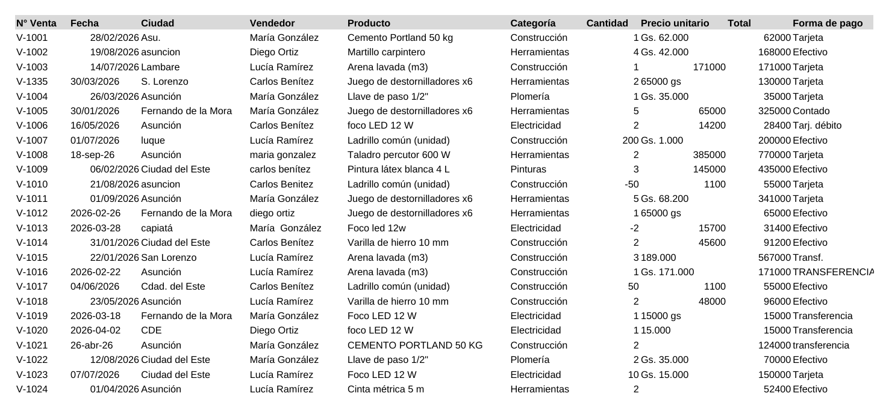
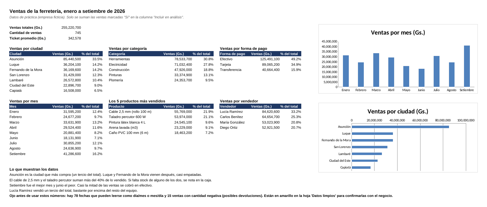

# Limpieza y análisis de ventas en Excel

Una ferretería tenía 9 meses de ventas cargadas a mano en una planilla: fechas en distintos formatos, ciudades escritas de mil maneras, precios guardados como texto, ventas repetidas y algunos totales mal calculados. Con esos datos no se podía sacar ni el total vendido.

El objetivo fue dejar la planilla ordenada y armar un resumen que responda preguntas simples: cuánto se vendió, dónde, qué productos y en qué meses.

> Los datos son de práctica (la empresa no existe). Usé herramientas de IA como apoyo durante el proceso.

## Antes

## Después

## Qué corregí

| Problema | Filas | Qué hice |
|---|---|---|
| Ventas repetidas | 28 | Eliminadas, quedó una de cada una |
| Filas vacías | 6 | Eliminadas |
| Fechas guardadas como texto (4 formatos distintos) | 347 | Convertidas a fecha real |
| Ciudades, vendedores, productos y formas de pago escritos distinto | más de 700 celdas | Unificados (ej.: "Asu.", "asuncion" y "ASUNCIÓN" pasaron a "Asunción") |
| Precios guardados como texto ("Gs. 62.000", "65000 gs") | 257 | Convertidos a número |
| Precio o cantidad vacíos | 42 | Calculados a partir del total |
| Totales que no coincidían con cantidad × precio | 23 | El total ahora es una fórmula |
| Cantidades negativas | 15 | Excluidas del análisis y marcadas (pueden ser devoluciones) |
| Fechas que se pueden leer como día/mes o mes/día | 78 | Tomadas como día/mes y marcadas para confirmar |

De 794 filas quedaron **760 ventas**, y **745** entran en el análisis. Todo lo que se cambió o que conviene revisar está anotado en la hoja **Registro de cambios** y marcado en amarillo en **Datos limpios**.

## Lo que salió del análisis

- Se vendieron **Gs. 255.220.700** en 745 ventas (ticket promedio de Gs. 342.578).
- **Asunción** se lleva un tercio de las ventas.
- El **cable de 2,5 mm** y el **taladro percutor** juntos son más del 40% de lo vendido.
- **Setiembre** fue el mejor mes y **junio** el peor.
- Casi la mitad se cobró en **efectivo**.
- **Lucía Ramírez** vendió un tercio del total.

## Cómo está armado el archivo

| Hoja | Qué tiene |
|---|---|
| Resumen | Totales y tablas por ciudad, categoría, forma de pago, mes, producto y vendedor, con dos gráficos |
| Datos limpios | La planilla corregida, con filtros y una columna de observaciones |
| Registro de cambios | Cada problema encontrado, cuántas filas afectó y qué se decidió |
| Datos originales | La planilla tal como llegó, sin tocar |

Los números del resumen son fórmulas (SUMIFS, COUNTIF), no valores pegados: si se corrige un dato, el resumen se actualiza solo.

## Archivos

- [`datos/ventas_ferreteria_2026_SIN_LIMPIAR.xlsx`](datos/ventas_ferreteria_2026_SIN_LIMPIAR.xlsx): la planilla original.
- [`datos/ventas_ferreteria_2026_LIMPIO_Y_ANALIZADO.xlsx`](datos/ventas_ferreteria_2026_LIMPIO_Y_ANALIZADO.xlsx): la planilla limpia con el resumen.

---

Maximiliano Benítez Parodi · Estudiante de Análisis de Sistemas (Universidad Católica, Paraguay)
